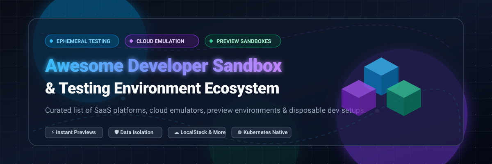

# ⚡ Awesome Developer Sandbox & Testing Environment Ecosystem 🧪

  
  
  
  
  
  

**A curated index of top developer sandbox platforms, ephemeral preview environments, cloud emulators, and test environment orchestration tools.**

*Empowering developers, QA engineers, DevOps practitioners, and platform teams to build safely without touching production.*

---

## 📑 Table of Contents
- [📌 Overview & Key Concepts](#-overview--key-concepts)
- [📊 Sector Overview & Market Dynamics](#-sector-overview--market-dynamics)
- [🏢 SaaS & Hosted Platforms](#-saas--hosted-platforms)
- [💻 Open-Source GitHub Projects](#-open-source-github-projects)
- [💡 Architectural Guide: How to Choose](#-architectural-guide-how-to-choose)
- [🤝 How to Contribute](#-how-to-contribute)
- [💖 Support & Sponsorship](#-support--sponsorship)
- [📈 Star History](#-star-history)
- [⚠️ Disclaimer](#️-disclaimer)

---

## 📌 Overview & Key Concepts

This repository tracks premier **SaaS platforms** and **open-source software** across the **Developer Sandbox & Testing Environment** spectrum. 

Modern distributed architectures, microservices, and AI-assisted engineering workflows demand isolated and disposable copies of services, data, and third-party dependencies. These tools solve key enterprise friction points:
* 🛡️ **Zero Production Risk:** Test schema migrations, breaking changes, and experiments without endangering live user data.
* ⚡ **Pull-Request Ephemeral Previews:** Spin up an exact, isolated environment automatically on commit and tear it down on merge.
* 💸 **FinOps & Cloud Cost Optimization:** Replace 24/7 idle staging clusters with on-demand, auto-sleeping sandboxes.
* ☁️ **High-Fidelity Cloud Emulation:** Mock AWS, GCP, and Azure APIs locally to eliminate per-developer cloud bills and enable offline development loops.

---

## 📊 Sector Overview & Market Dynamics

The Test Environment-as-a-Service (TEaaS) and Environments-as-a-Service (EaaS) sector is estimated at **$17.7B to $20B+** globally, projected to reach over **$40B–$60B+ by the early 2030s** at an estimated CAGR of 14%–19%. The sector remains **highly fragmented**, characterized by open-core platforms, specialized startups targeting ephemeral pull-request previews and local cloud emulation, and competing native capabilities offered by hyperscalers and DevOps git-hosts.

---

## 🏢 SaaS & Hosted Platforms

| Product | Company Size (Valuation / Revenue) | Description | Starting Pricing | Free Tier / Free Trial Limits |
|:---|:---|:---|:---|:---|
| **[Salesforce Sandboxes](https://www.salesforce.com/platform/sandboxes-environments/pricing/)** | ~$180B Market Cap / ~$41.5B Revenue | Four sandbox types: **Developer** (metadata only, included with core CRM licenses), **Developer Pro** (5% of net spend), **Partial Copy** (20% of net spend), **Full Copy** (30% of net spend). Scratch Orgs start at $25/org/month. Base Salesforce CRM Starter Suite begins at $25/user/month. | **Included Free**: 1 to 100 Developer Sandboxes (200 MB test data, daily refresh) bundled per CRM license edition; **Free Trial**: 30-day free trial on Starter Suite. |
| **[Zoho CRM Developer Edition](https://www.zoho.com.cn/crm/developer/developer-edition.html)** | ~$12.5B Valuation / ~$1.4B Revenue | Dedicated, full-featured development environment for Zoho CRM to test custom modules, Deluge functions, and workflows. Paid production Zoho CRM tiers start at $14/user/month (billed annually) or $20/user/month (monthly). | **Free Forever**: 1 developer user account, up to 5,000 records, 10 MB data storage (strictly isolated for testing/development). |
| **[LocalStack](https://localstack.cloud/)** | ~$100M–$250M Valuation (~$28.2M Funded) / ~$7M ARR | Local AWS and Snowflake cloud emulator for rapid testing and CI/CD offloading without cloud spend. | **Base Tier**: $39/user/month (AWS emulator, annual billing) or $45/user/month (monthly billing). | **Hobby Plan (Free Forever)**: 30+ core emulated AWS services, non-commercial personal use only, requires account & auth token; **Free Trial**: 45-day free trial for paid tiers. |
| **[Release.com](https://releasehub.webflow.io/pricing)** | ~$80M Valuation (~$22.9M Funded) / ~$5M ARR | Environments-as-a-Service (EaaS) platform spinning up full-stack ephemeral environments directly inside your cloud (AWS/GCP) on every commit. | **Custom / Enterprise**: Tailored quotes based on cloud architecture and environment scale (runs BYOC in customer AWS/GCP). | **Free Trial / Sandbox Tier**: 5 free environment/compute hours upon registration; free sandbox tier includes 100 managed pre-production environment hours/month. |
| **[Okteto](https://www.okteto.com/pricing/)** | ~$50M–$100M Valuation (~$18.1M Funded) / ~$4M ARR | Kubernetes-native development platforms with automated preview environments for pull requests and development sandboxes. | **Scale Plan**: Custom quote per user seat (billed annually; previous Developer Pro tier started at $19/user/month). | **Starter Plan (Free Forever)**: Free for up to 5 users, unlimited ephemeral and dev environments on self-hosted Kubernetes, community support. |
| **[Bunnyshell](https://www.bunnyshell.com/staging-management/)** | ~$10M–$15M Valuation (~$10M Funded) / ~$3M ARR | Self-service staging and preview environments with auto-sleep functionality reducing idle infrastructure spend by 40–60%. | **Startup Plan**: $0.007 per active environment minute (~$0.42/active hour, $0/month idle cost); Scaleup/Enterprise quotes for teams >20 users. | **Free Trial**: 14-day fully featured free trial with unlimited users and no credit card required; free Starter tier includes 5 ephemeral environments. |
| **[Uffizzi](https://www.uffizzi.com/)** | ~$10M Valuation (~$2.8M Funded) / ~$2M ARR | Ephemeral environments and internal developer platform providing full-stack preview clusters per pull request with service and database dependencies. | **Pro Plan**: ~$9 to $20/seat/month based on infrastructure deployment model; custom for Dedicated/Enterprise. | **Starter Plan (Free Forever)**: 2 concurrent ephemeral preview environments, unlimited team member accounts, version control integration. |
| **[Shipyard](https://shipyard.build/pricing/)** | Seed-stage (~$2.3M Funded, Acquired by StackGen) / ~$1M ARR | Automated preview environments and disposable ephemeral stacks for pull requests and AI agents. | **Startup Tier**: $500/month flat rate (includes 3 concurrent Drydock environments; additional Drydocks at $100/month). | **Free Trial**: 30-day free proof-of-concept trial with full feature and integration access (no permanent free tier). |

---

## 💻 Open-Source GitHub Projects

Curated list of self-hosted developer sandboxes, cloud emulators, virtual clusters, and preview orchestration engines. Sorted in descending order of GitHub community stars:

| Repository & Link | GitHub Stars | License | Description & Ecosystem Focus |
|:---|:---:|:---:|:---|
| **[Daytona](https://github.com/daytonaio/daytona)** |  | Apache-2.0 | Open-source development environment manager. Manages automated, standardized dev environments and sandboxes on any infrastructure with a single CLI command. |
| **[LocalStack](https://github.com/localstack/localstack)** |  | Apache-2.0 / Commercial | The pioneer local cloud emulator for AWS. Emulates Lambda, S3, DynamoDB, SQS, and dozens of cloud APIs directly on localhost/CI. |
| **[Floci](https://github.com/floci-io/floci)** |  | MIT | Ultra-lightweight, fluffy, and always-free local AWS emulator alternative with sub-20ms cold starts and native authentication-free local testing. |
| **[Coder](https://github.com/coder/coder)** |  | AGPL-3.0 | Self-hosted remote development environment platform. Provision developer sandboxes via Terraform into Kubernetes, Docker, and multi-cloud VMs. |
| **[Gitpod](https://github.com/gitpod-io/gitpod)** |  | AGPL-3.0 | Automated cloud development environments natively integrated with GitHub, GitLab, and Bitbucket for instant sandbox workspaces. |
| **[vcluster (Loft)](https://github.com/loft-sh/vcluster)** |  | Apache-2.0 | Create fully functional, isolated virtual Kubernetes clusters inside a shared host cluster—ideal for multi-tenant developer sandboxes. |
| **[Moto](https://github.com/getmoto/moto)** |  | Apache-2.0 | Battle-tested Python library that lets developers mock out AWS services and SDK calls offline in unit tests and local sandboxes. |
| **[DevSpace](https://github.com/devspace-sh/devspace)** |  | Apache-2.0 | Client-only developer tool for Kubernetes. Instantly deploys reproducible testing environments and syncs code directly into running containers. |
| **[Okteto CLI](https://github.com/okteto/okteto)** |  | Apache-2.0 | CLI for building, deploying, and developing apps in Kubernetes-powered ephemeral environments and remote dev workspaces. |
| **[fakecloud](https://github.com/faiscadev/fakecloud)** |  | AGPL-3.0 | Zero-auth, single-binary local cloud emulator for AWS. Fast ~300ms boot time, low memory footprint (~30 MiB), and free commercial usage. |
| **[Uffizzi Core](https://github.com/UffizziCloud/uffizzi)** |  | Apache-2.0 | Self-serve internal developer platform and ephemeral preview environment engine built on virtual Kubernetes clusters. |
| **[AWS Innovation Sandbox](https://github.com/aws-samples/aws-innovation-sandbox)** |  | MIT-0 | AWS solution for automated vending of clean, isolated AWS accounts with cost controls, policy guardrails, and auto-teardown. |

---

## 💡 Architectural Guide: How to Choose

* 🚀 **For Ephemeral PR Previews (Full-Stack Applications):**  
  Choose **Bunnyshell** or **Release.com** for managed turnkey SaaS; choose **Okteto** or **vcluster** for Kubernetes-native infrastructure; choose **Uffizzi** for virtual clusters.
* ☁️ **For Local AWS Cloud Emulation & Offline CI:**  
  Choose **LocalStack** for comprehensive AWS API coverage; choose **fakecloud** or **Floci** for lightweight zero-auth single-binary alternatives; choose **Moto** for embedded Python test fixtures.
* 💻 **For Remote Workspaces & Cloud Developer Environments (CDEs):**  
  Choose **Daytona** for multi-cloud dev environments or **Coder** / **Gitpod** for infrastructure-as-code dev environments.
* 🏢 **For CRM & Enterprise Sandbox Workflows:**  
  Use **Salesforce Scratch Orgs** for disposable CLI testing; use **Zoho CRM Developer Edition** for sandbox prototyping.

---

## 🤝 How to Contribute

Contributions are welcome and appreciated! To add a new platform or update existing metrics:

1. 🍴 Fork the repository.
2. 📝 Update `README.md` following the tabular format and verified pricing/stargazer conventions.
3. 🔗 Ensure all URLs, GitHub links, and star badges point accurately to official sources.
4. 🚀 Submit a Pull Request with a brief summary of additions or updates.

---

## 💖 Support & Sponsorship

If you find this curated directory helpful for navigating developer sandboxes, cloud emulators, and ephemeral testing environments, please consider supporting the project:

- ⭐ **Star this repository** to help others discover it!
- 🍴 **Fork & Share** with your developer and DevOps communities.
- ☕ **Buy me a coffee & support ongoing research**: [**Sponsor Dashboard on GitHub**](https://github.com/sponsors/ishandutta2007)

*Thank you for supporting open-source software and developer productivity!*

---

## 📈 Star History

---

## ⚠️ Disclaimer

- This is an independent, community-curated directory — not an endorsement of any listed vendor or platform.
- Sandbox environments often handle sensitive metadata or sanitized data; always implement strict data anonymization, credential scrubbing, and automatic teardown policies.
- Free tier limits and commercial policies change periodically. Always verify terms with official vendor documentation before committing production workloads.

---

  <b>Built with ❤️ for developers, platform engineers, and QA teams.</b> 
  Empowering faster, safer, and cost-predictable developer testing workflows.

